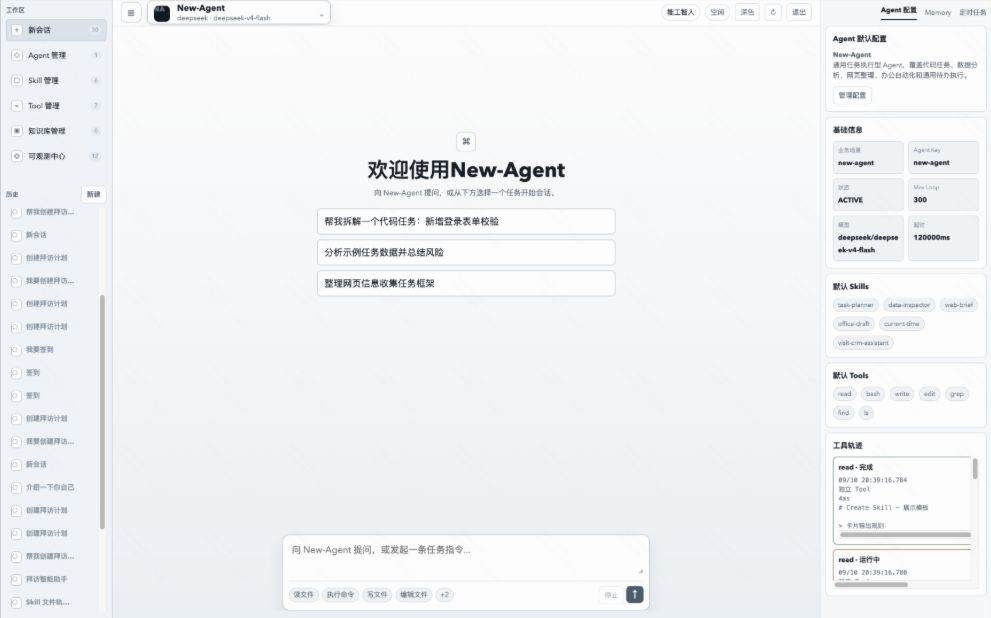
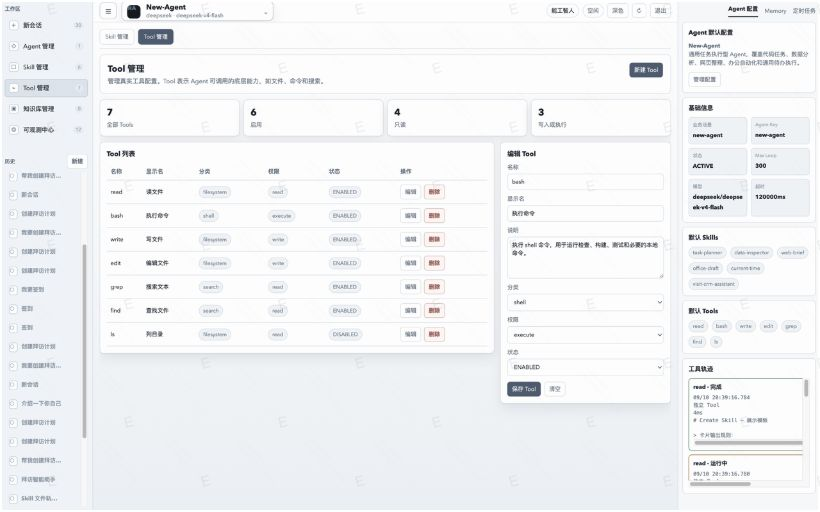
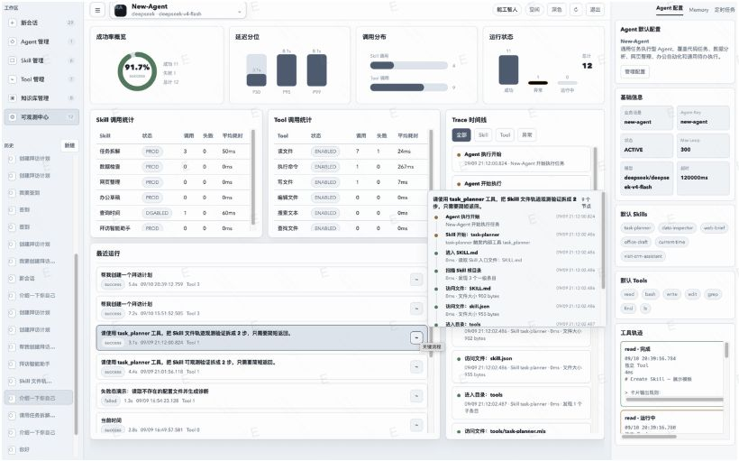
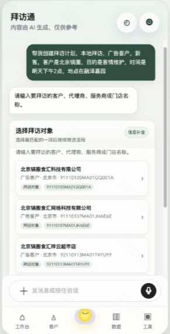
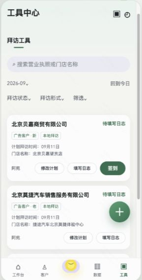

# New-Agent

**把自然语言任务变成可执行、可确认、可追踪的工作流程。**

New-Agent 是基于 Pi Agent SDK 构建的 AI Agent 应用，包含通用 Agent 工作台和面向销售拜访的业务助手。你可以在工作台配置 Agent、Skill 和工具，通过对话处理任务；也可以在拜访助手里创建计划、完成签到签退、填写日志，让一次拜访从安排到记录形成完整流程。

项目适合用来学习 Agent 应用开发、搭建内部任务助手，或作为销售拜访场景的二次开发基础。

[功能概览](#功能概览) · [两个页面怎么用](#两个页面怎么用) · [项目亮点](#项目亮点) · [下载与运行](#下载与运行) · [接入拜访业务后端](#接入拜访业务后端) · [常见问题](#常见问题)

## 界面预览



*通用 Agent 工作台：左侧管理资源与会话，中间发起任务，右侧查看配置和执行过程。*

## 功能概览

### 通用 Agent 工作台

| 功能 | 可以做什么 |
| --- | --- |
| 对话执行任务 | 通过自然语言发起任务，查看流式回复和工具执行结果。 |
| Agent 管理 | 配置 Agent 的提示词、可用 Skill 和工具，组合不同任务能力。 |
| Skill 与 Tool 管理 | 用 Skill 组织任务方法，用 Tool 提供执行动作；支持工具启停与权限配置。 |
| 文件与命令工具 | 使用 `read`、`write`、`edit`、`bash`、`grep`、`find`、`ls` 处理文件、检索内容或执行命令，实际可用范围受权限策略控制。 |
| 多会话与持久化 | 分开保存不同任务的上下文，查看会话树，并在服务重启后继续已有会话。 |
| 操作审批 | 对触发审批策略的工具操作进行人工确认，再决定是否执行。 |
| 运行观测 | 查看 Run、Trace、工具调用、耗时、Token、成本和告警，排查执行问题。 |
| 评测与报告 | 管理评测用例和数据集版本，进行基线对比、发布门禁及人工复核，并导出 Markdown 评测报告。 |
| 登录与用户隔离 | 支持注册、登录和退出，按用户隔离会话、状态及运行记录。 |

### 拜访业务助手

拜访助手把销售人员的日常操作串成一条流程：

```text
查询待办 → 创建 / 调整计划 → 到访签到 → 录音与记录 → 签退 → 填写日志 → 提交审核
```

| 业务环节 | 支持的操作 |
| --- | --- |
| 待办与计划 | 查询待签到、待签退、待填写日志的任务；创建、修改、取消拜访计划。 |
| 客户与地址选择 | 补充客户、拜访目的、时间和地址；有多个匹配结果时通过卡片选择。 |
| 签到与签退 | 选择拜访计划、校验位置、提交签到或签退；异常情况由后端规则校验。 |
| 拜访日志 | 维护联系人、填写或修改纪要、保存日志并提交审核。 |
| 语音与录音 | 提供语音输入、拜访录音及转写入口；实际转写、音频存储需要配置外部服务。 |
| 业务确认 | 信息补齐后先确认，再由后端状态机校验并执行，减少遗漏和重复操作。 |

**工作台由 `New-Agent` 启动；拜访计划、签到、日志等真实业务操作还需要独立的 Spring Boot 后端。** 客户向量检索依赖 Milvus 等配置，语音链路依赖 ASR / OSS 等服务。没有这些配置时，不能把界面入口视为完整业务已经可用。


## 两个页面怎么用

New-Agent 面向两类日常工作：一类是需要调用工具、持续处理任务的通用工作；另一类是有明确业务规则的销售拜访。工作台负责组织能力、执行任务和查看过程，拜访助手负责让一线人员按业务流程完成具体操作。

| 使用者 | 主要入口 | 可以得到的帮助 |
| --- | --- | --- |
| 任务执行人员、开发者 | 通用 Agent 工作台 | 用对话发起任务，使用配置好的工具，保留上下文并查看执行结果。 |
| 销售、BD、客户拜访人员 | 拜访助手 | 用自然语言安排拜访，按提示补齐信息，继续处理签到、签退和日志。 |
| 应用维护、测试人员 | 工作台的配置、观测与评测界面 | 调整能力边界，定位失败环节，比较不同配置下的任务表现。 |

### 1. 通用 Agent 工作台：从提出任务到查看执行结果

本地地址：<http://localhost:3100/>

#### 第一步：进入工作台，明确要处理的任务

第一次打开页面先注册并登录。左侧是会话与资源管理入口，中间用于输入任务、查看回复，右侧展示当前 Agent 的配置和执行信息。

例如，需要了解一个陌生项目时，可以先发起一个只读任务：

> 先列出当前项目的目录，找出启动入口和主要配置文件，按“文件位置、作用、下一步建议”整理给我，暂时不要修改文件。

系统根据当前 Agent 的能力调用文件读取、目录查看或检索工具，再把结果组织成回复。实际能做哪些操作，由 Agent、Skill 和 Tool 的配置共同决定。

**使用价值**：使用者可以先描述目标，再沿着同一段对话补充要求；减少为了收集信息而逐个打开目录、来回复制内容的操作。结果仍可结合具体文件和工具返回进行核对。

#### 第二步：为任务配置合适的能力

在 Agent 管理中设置角色与任务要求，通过 Skill 组织处理方法，再配置允许调用的工具。例如，查阅项目资料时开放读取和检索工具；需要修改文件时，再按任务要求启用写入、编辑或命令执行能力。



*工具管理将文件读取、文件写入、检索和命令执行等能力集中展示，便于按任务控制使用范围。*

| 配置层 | 负责什么 | 对使用者的价值 |
| --- | --- | --- |
| Agent | 确定角色、目标和任务约束 | 不同工作可以使用不同的助手配置。 |
| Skill | 描述处理某类任务的方法和步骤 | 将经常使用的方法保留下来，后续重复调用。 |
| Tool | 提供读取、检索、写入或执行等具体动作 | 明确哪些操作能做、哪些操作需要限制。 |

**使用价值**：常用任务的方法和工具配置可以复用，减少每次从头解释要求的负担；维护人员也能在一个地方管理能力，避免使用者不清楚助手的操作范围。

#### 第三步：边执行边查看，关键操作由人确认

在对话过程中查看流式输出和工具调用结果。遇到触发审批策略的操作时，先核对操作内容，再决定允许或拒绝。

例如，任务涉及修改文件时，可以先让 Agent 读取并说明修改方案，再根据工具权限及审批策略执行。审批是否出现取决于当前策略，并非所有操作都会弹出确认。

**使用价值**：使用者可以在执行过程中发现偏差、补充要求；涉及写入或执行时，也有机会在策略要求的确认节点介入，降低误操作风险。

#### 第四步：保留会话，下次接着处理

不同任务使用不同会话，避免把多个项目的要求混在一起。历史消息、工具结果和会话树会随所选存储方式保存，服务重启后可以重新打开已有会话继续交流。

例如，今天完成目录梳理，下一次可以在原会话中继续说：

> 根据前面找到的入口和配置，继续梳理登录请求经过哪些模块。

**使用价值**：减少重复介绍背景、重新查找先前结论的操作。继续会话会恢复已保存的上下文；中断时未完成的外部操作仍需核对结果后再决定是否重试。

#### 第五步：查看运行记录，定位问题并验证改动

在可观测中心查看运行记录、工具调用顺序、耗时、Token、成本和告警；需要验证改动效果时，再使用评测用例、数据集与基线比较。



*从整体运行状态进入具体调用轨迹，帮助定位耗时、失败或结果异常的环节。图中统计值为界面示意。*

例如，助手执行失败时，维护人员可以先找到对应 Run，再核对是模型返回异常、工具调用失败，还是业务接口没有满足执行条件。修改配置后，用同一组评测用例比较结果，减少仅凭单次聊天判断效果的偏差。

**使用价值**：排查问题时有记录可查，减少盲目重试；提示词、工具配置或处理流程调整后，也更容易说明改变了什么、效果如何。

### 2. 拜访助手：把一次拜访从安排到记录串起来

本地地址：<http://localhost:3100/assistant/chat>

先在工作台登录，再打开此页面。也可以通过 `/visit-assistant.html` 访问。完整操作需要接入拜访业务后端；客户选择、语音转写等能力还需要相应的数据和服务配置。

#### 场景一：用一句话开始安排拜访

外出人员可以直接描述意图，例如：

> 帮我创建明天下午两点的本地拜访计划，拜访客户 A，目的是客户维护，地点是客户门店。

助手进入相应业务流程，按需要继续补充客户、时间、目的和地址等信息。示例中的客户名称要替换为系统中真实可查的数据。



*先表达想做的事，再按卡片完成客户选择，无需在一开始就记住所有必填信息。*

**使用价值**：使用者可以从“我要拜访谁、什么时候去、去做什么”开始，不必先熟悉完整的菜单和表单结构。输入不完整时，通过后续提示逐步补齐。

#### 场景二：信息不确定时，通过选择卡片补齐

同一客户关键词可能对应多个门店或企业，拜访地址也可能有多个候选。助手会展示相应候选项，由人员选择实际对象；信息不足时继续询问，再进入后续步骤。

这里的重点是把“理解一句话”和“执行一笔业务操作”分开：前者用于收集意图，后者需要明确的客户、地址、时间以及业务状态。

**使用价值**：减少记错名称、遗漏字段或选错对象的风险。对不熟悉客户编码的人员，也可以通过可读的名称和卡片完成选择，而不是手工填写内部标识。

#### 场景三：核对计划，再提交并查看结果

补齐必要信息后，先核对客户、拜访方式、目的、时间和地址，再确认提交。后端校验业务状态及执行条件，通过后返回创建结果。

提交后通过结果卡查看已创建的计划信息，包括客户、拜访方式、目的、时间、地址和计划编号，方便确认本次操作实际创建了什么。

**使用价值**：人员可以在提交前集中检查重要字段，提交后又有明确结果可核对。后端状态校验与幂等机制帮助拦截非法流转和重复请求，降低重复创建或误提交的风险。

#### 场景四：从待办和计划列表继续处理工作

计划创建之后，还会产生签到、签退、填写日志等后续事项。人员可以查询待处理任务，再从计划列表进入对应操作。



*列表把当前计划与可继续执行的操作放在一起，便于找到下一步。*

| 拜访阶段 | 人员需要做什么 | 系统提供的帮助 |
| --- | --- | --- |
| 拜访前 | 安排时间、确认客户和地点 | 创建、查询、修改或取消计划，按提示补齐信息。 |
| 到访时 | 选择计划并签到 | 校验位置和业务状态，按规则处理异常签到。 |
| 拜访中 | 留下录音与沟通记录 | 提供录音入口；接通语音服务后处理转写结果。 |
| 拜访后 | 签退、补充联系人和纪要 | 提供签退预检、日志填写与修改流程。 |
| 记录完成后 | 提交审核 | 校验必要信息并推进审核流程，保留业务操作记录。 |

**使用价值**：人员不必只靠记忆追踪“哪家还没签到、哪次还没签退、哪份日志没补”，可以从待办进入对应任务。计划变动后也能继续修改或取消，减少信息散落在聊天记录和个人备忘中的情况。

#### 场景五：把现场沟通沉淀为拜访记录

拜访结束后，按提示补充联系人、沟通纪要等内容，再保存日志并提交审核。需要语音辅助时，可以使用语音输入或录音入口；实际音频存储和转写需要配置 ASR / OSS 等服务，录音纪要仍需人员核对和补充。

**使用价值**：将沟通记录和对应拜访放在同一流程中，减少结束后凭记忆重新整理的负担，也便于后续回看这次拜访的对象、时间和记录。

录音、定位和拍照需要浏览器权限；远程访问时应使用 HTTPS。界面导航和业务数据随接入环境而变化，项目的独立助手入口是 `/assistant/chat`。

### 3. 项目使用价值

| 常见工作负担 | New-Agent 的处理方式 | 使用价值 |
| --- | --- | --- |
| 为了完成一件事，在多个菜单或页面中查找入口 | 从对话发起任务，再由流程引导到具体操作 | 减少入口查找和页面切换。 |
| 一开始就要记住完整的表单字段 | 先描述意图，再逐步补齐信息 | 减少使用前需要记忆的步骤。 |
| 客户或门店名称相近，容易选错 | 展示候选卡片，由人员确认实际对象 | 降低对象歧义带来的误填风险。 |
| 一项工作中断后，需要重新解释背景 | 保存会话、历史结果和上下文 | 减少重复说明与重新整理。 |
| 拜访结束后，容易漏掉签退或日志 | 按任务状态提供待办和后续入口 | 更容易找到尚未完成的事项。 |
| 助手失败后，只能反复尝试 | 提供运行记录、工具轨迹和错误信息 | 让维护人员有依据地排查。 |
| 每次换一种任务都要重新说明处理方法 | 通过 Agent、Skill 和 Tool 组合能力 | 复用配置与方法，减少重复设置。 |

上述使用价值来自流程整合、信息补齐、记录保存和可观测能力。实际节省的时间及操作次数，会随任务复杂度、数据质量和服务配置而变化。

## 项目亮点

### 自然语言入口与业务卡片结合

人员先用熟悉的语言表达目标，再通过客户选择、信息补齐和确认卡完成准确操作。对话承担引导，卡片承担明确选择，适合既需要灵活表达、又需要结构化数据的工作。

### 从安排计划延伸到拜访记录

计划、签到、签退、日志和审核共用一条业务链路。助手不仅提供创建入口，也帮助人员继续完成后续事项，使一次拜访能够留下可回看的过程和记录。

### 模型负责理解，业务后端负责校验和执行

拜访业务将意图理解与最终写操作分开，由后端状态机、权限校验和幂等机制约束执行。即使自然语言输入不完整或请求重复，也需要满足业务规则才能推进。

### 能力可以配置和复用

Agent、Skill 与 Tool 分层组织，使角色、方法和具体操作各自明确。扩展其他任务时，可以复用已有执行能力，再增加场景方法；具体新场景仍需配置和开发接入。

### 执行过程可查看，效果可以评测

运行观测回答“执行过程中发生了什么”，评测和基线比较帮助判断“调整后表现是否变化”。两者结合，便于维护人员定位问题和验证改动。

### 任务上下文可以延续

多会话隔离与持久化让不同任务分别保存背景和执行记录，减少跨任务混淆，也让后续跟进有据可依。


## 下载与运行

### 环境准备

| 环境 | 用途 |
| --- | --- |
| Node.js **22.19.0 或更高版本**及 npm | 运行 New-Agent；此要求来自项目锁定的 Pi SDK。 |
| 可用的模型账号或 API Key | 工作台启动前必须能通过 Pi SDK 发现至少一个可用模型。 |
| Python 3（使用 Python Skill 时） | 执行拜访等 Skill 包中的 Python 工具。 |
| MySQL 8（可选） | 使用数据库持久化；首次体验可以使用文件存储。 |

> 打开页面需要先启动服务，不能直接双击 `index.html`。前端和接口由同一个 Node.js 服务提供，无需另起前端开发服务。

### 第一步：下载项目并安装依赖

在 [GitHub 仓库](https://github.com/dengtaqq/new-agent)中选择 **Code → Download ZIP**，解压后进入其中的 `New-Agent` 子目录，该目录包含主应用的 `package.json`。

也可以使用 Git 下载：

```bash
git clone https://github.com/dengtaqq/new-agent.git
cd new-agent/New-Agent
npm ci
```

使用 ZIP 下载时，在解压后的 `New-Agent` 目录执行同样的 `npm ci`。仓库目前为私有，需要使用有访问权限的 GitHub 账号下载。

### 第二步：连接模型

安装依赖后，在 `New-Agent` 目录运行项目自带的 Pi 命令行：

```bash
npx --no-install pi
```

在 Pi 中输入 `/login`，选择你自己的模型服务商并完成登录或 API Key 配置，然后用 `/model` 检查是否能看到可用模型。完成后退出 Pi，回到终端。

New-Agent 使用 Pi 的模型与凭据配置。需要连接自定义兼容接口时，按照安装包中的 Pi 模型配置文档 `node_modules/@earendil-works/pi-coding-agent/docs/models.md`配置 `models.json`；该文档在执行 `npm ci` 后才存在。不要把 API Key 或 Pi 凭据文件上传到仓库。

### 第三步：创建本地配置

将 `New-Agent/.env.example` 复制为同目录的 `.env`，用文本编辑器加入以下两行，即可先使用文件存储体验工作台：

```dotenv
PORT=3100
NEW_AGENT_STORAGE=file
```

如果需要固定使用某个模型，再增加 `AGENT_MODEL=服务商/模型ID`，将右侧替换为 Pi 中实际可用的标识；未设置时，服务使用第一个可用模型。

文件存储会把账号、应用状态及会话保存到本地数据目录，适合个人体验和开发。MySQL 配置见下文。

### 第四步：启动并打开页面

仍然在 `New-Agent` 目录执行：

```bash
npm start
```

终端出现服务监听信息且没有启动错误后，打开：

| 页面 / 检查地址 | 用途 |
| --- | --- |
| <http://localhost:3100/> | 注册、登录和使用通用 Agent 工作台。 |
| <http://localhost:3100/assistant/chat> | 拜访助手；完整业务需要额外启动拜访后端。 |
| <http://localhost:3100/health/live> | 检查服务进程是否存活。 |
| <http://localhost:3100/health/ready> | 检查存储是否就绪。 |

开发时可使用 `npm run dev`，修改服务代码后自动重启。停止服务时，在启动它的终端按 `Ctrl+C`。

### 可选：改用 MySQL 保存数据

先启动自己的 MySQL 8 服务，在 `New-Agent` 目录执行一次初始化：

```bash
mysql -u root -p < database/001-new-agent.sql
mysql -u root -p new_agent < database/002-observability.sql
```

然后将 `.env` 中的存储配置替换为：

```dotenv
NEW_AGENT_STORAGE=mysql
MYSQL_HOST=127.0.0.1
MYSQL_PORT=3306
MYSQL_DATABASE=new_agent
MYSQL_USER=root
MYSQL_PASSWORD=替换为你自己的数据库密码
```

重新运行 `npm start`。应用启动时只校验连接与表结构，不会自动建库建表。切换存储方式不会自动搬迁之前的文件数据。

## 接入拜访业务后端

仓库根目录的 `locallife-vist.zip` 包含独立业务服务。它负责拜访状态流转、业务校验及最终写操作，New-Agent 通过同源 `/api/visit/*` 代理访问它。

1. 解压 `locallife-vist.zip`，进入解压后的 `locallife-vist` 目录。
2. 准备 Java 11、Maven、MySQL 和 Redis。按后端 `README.md` 和 `src/main/resources/application.yml` 配置数据库、Redis 等连接参数；使用自己的账号和密码。
3. 配置后端的 `MYSQL_URL`、`MYSQL_USERNAME`、`MYSQL_PASSWORD`、`REDIS_HOST`、`REDIS_PORT` 等环境变量，并确保数据库已存在、账号有迁移权限。业务表由 Flyway 管理。
4. 在业务服务目录执行 `mvn spring-boot:run`。
5. 在 `New-Agent/.env` 加入或确认 `VISIT_API_BASE_URL=http://127.0.0.1:8080`。

6. 重启 New-Agent，在工作台登录后打开 `/assistant/chat`，检查拜访后端健康状态及数据加载情况。

**两个数据库用途不同：**工作台使用 `new_agent`，拜访后端默认使用 `locallife_visit`。仅启动 New-Agent 或仅初始化 `new_agent`，不足以完成真实拜访操作。

客户选择需要按后端说明接入 Milvus 和客户数据；录音转写需要配置 ASR 与 OSS。客户同步、语音等扩展配置请以解压后的业务服务 `README.md` 为准。

## 常见问题

| 现象 | 处理方式 |
| --- | --- |
| 启动提示“没有可用模型” | 在 `New-Agent` 目录运行 `npx --no-install pi`，完成 `/login`，并用 `/model` 检查凭据与模型是否可用。 |
| 启动提示“指定模型不可用” | 检查 `.env` 中的 `AGENT_MODEL`；需要与可用模型标识一致，也可先删除该项使用默认模型。 |
| MySQL 连接失败或缺表 | 核对账号、密码和端口，执行两个初始化脚本；只体验工作台时可先切换为 `NEW_AGENT_STORAGE=file`。 |
| 3100 端口被占用 | 在 `.env` 中改为其他空闲端口，如 `PORT=3101`，重启后使用对应的新地址。 |
| 工作台能打开，但拜访助手报错 | 检查 Spring Boot 是否启动、`VISIT_API_BASE_URL` 是否正确，以及当前账号是否已登录。 |
| 客户列表为空或录音不可用 | 核对客户数据、Milvus、ASR / OSS 配置及浏览器权限。这些能力需要额外服务。 |
| Python Skill 执行失败 | 检查 Python 3、脚本所需依赖及 Skill 的接口配置；页面代理配置与各 Python 工具配置应分别核对。 |

## 项目结构

```text
new-agent/
├── README.md                  # 项目介绍、配图与运行指南
├── README.en.md               # 源仓库附带的英文说明
├── .gitignore                 # 源仓库忽略规则
├── .DS_Store                  # 源仓库附带的 Mac 文件夹设置，不参与运行
├── package-lock.json          # 源仓库外层锁文件，主应用安装依赖使用内层锁文件
├── docs/images/               # 本文界面配图
├── New-Agent/                 # 主应用，在这里安装依赖并启动
│   ├── package.json
│   ├── package-lock.json
│   ├── .env.example
│   ├── public/                # 工作台与拜访助手页面
│   ├── src/                   # 服务接口、会话、策略、观测与评测
│   ├── skills/                # 当前时间、拜访助手等 Skill
│   ├── database/              # 工作台 MySQL 初始化脚本
│   ├── docs/                  # 主应用实现与部署说明
│   └── tests/                 # 主应用测试
└── locallife-vist.zip          # 拜访业务后端源码，解压并单独启动
```

安装和启动主应用时，请进入 `New-Agent` 目录；拜访业务后端则需要解压根目录的 `locallife-vist.zip`，按其说明配置并启动。两者通过 `VISIT_API_BASE_URL` 指定的地址连接。模型、数据库、Redis 以及按功能启用的外部服务仍需要自行配置。

开发检查可在 `New-Agent` 目录执行 `npm run typecheck` 和 `npm test`。更多实现细节见 [New-Agent 技术说明](New-Agent/README.md)；正式部署要求见 [运行时与生产配置](New-Agent/docs/production-runtime.md)。
